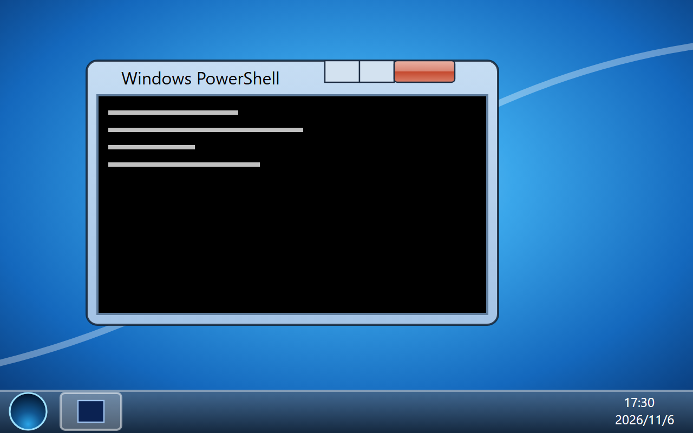

# Herdr 7（Windows 7 Aero）



一个 Windows 7 风格的 Herdr 桌面：`layouts/win7.json` + `themes/win7.json` + `mods/win7/`。
只用官方 mod / layout / theme 接口，不改 Herdr 核心、内置 Win98 或快捷键。

## 安装 / 更新

```powershell
node install.mjs            # 首次安装
node install.mjs --update   # 覆盖已安装的版本（旧版备份到 <home>/win7-backup-<时间>/）
herdr-app do layout.switch --name win7
```

默认装到 `HERDR_APP_HOME`，未设置时为 `~/.config/herdr-app`；也可以把目录作为第一个参数传入。
mod 文件先拷、`main.js` 最后拷，正在运行的 Herdr 会直接热加载完整的新版本。

## 你看到的

- **桌面**：蓝色光晕壁纸和四色窗口标志；左侧图标「计算机、回收站、Windows PowerShell、命令提示符、控制面板」，
  单击选中，双击打开。右键桌面：查看、**刷新**（图标闪一下，所有窗口重新对齐状态）、新建终端、新建工作区、个性化。
- **窗口**：每个终端 pane 都是一个可拖动的 Aero 窗口。毛玻璃边框（见下）、左上程序图标和带光晕的标题、
  顶边悬挂的最小化/最大化/关闭按钮（前台窗口的关闭键是红色）。双击标题栏最大化，右键标题栏是窗口菜单。
  关闭会先弹 Win7 风格的确认框，确认后才结束终端。
- **任务栏**（不合并、显示标签）：开始球、固定的 PowerShell、资源管理器、每个窗口一个带图标和名字的按钮，
  前台窗口高亮。代理在工作时按钮里有绿色进度条，等你处理时橙色闪烁，没看着时完成则保持橙色。
  右键按钮是跳转列表（新建窗口 / 最小化 / 关闭）。右侧：CH、通知区域（旗子在有代理等待时带红叉，点它跳过去）、
  两行时钟、最右边的「显示桌面」。
- **开始菜单**：左侧 PowerShell、命令提示符、OMP、Pi，下面是已安装的其他代理；「所有程序」把每个工作区列成文件夹。
  搜索框打开命令面板。右侧玻璃列：用户目录、文档、图片、下载、计算机、控制面板、设备和打印机、帮助和支持、运行…；
  悬停时头像框换成对应图标。「关机」关闭 Herdr 窗口（终端继续运行），箭头菜单：切换用户（下一个布局）、
  注销（回到 main）、重新启动（重开所有窗口）、睡眠（最小化）。
- **计算机（资源管理器）**：工作区是“硬盘”（容量条 = 终端数量），工作区里的每个终端是一个“文件夹”，
  带程序角标、状态和当前目录。双击打开对应窗口，「新建文件夹」= 在这个工作区新建终端，右键可删除（关闭终端）或重命名。

## 毛玻璃

Herdr 的 overlay 不能实时模糊背后的内容，但壁纸是固定的：玻璃部分（标题栏、窗口三边、任务栏、开始菜单、
资源管理器、对话框）各自画出**预先模糊的壁纸**里正好在自己背后的那一块，再叠一层 Aero 色调和高光。
窗口位置来自 Herdr 记录的 `windows.json`（拖动标题栏时实时跟随鼠标）。所以它透出的是模糊的桌面，
不会透出叠在下面的其他窗口。

## Claude Code

在 Windows 上，从 PowerShell 里启动的 Claude Code 不发 OSC 7501，herdr-core 也只看到 `powershell.exe`，
所以 Herdr 本身认不出它。这个主题每 1.5 秒用 `hc get` 读终端原始标题：`✳` 开头是等待中，盲文转圈字符开头是工作中，
据此把窗口显示成 Claude Code（图标、名字、绿色进度、完成时橙色并播放提示音）。
这只在 Herdr 7 布局里生效；Herdr 自带的代理列表和通知仍然认不出它（那需要 herdr-core 在 Windows 上识别前台进程）。

## 按键（可选）

`keys.json` 里可以加：

```json
"layout:win7": { "ctrl-escape": "win7.start", "ctrl-alt-d": "win7.desktop", "ctrl-alt-e": "win7.explorer" }
```

## 美术

`art/gen.mjs` 生成壁纸、开始球（`node art/gen.mjs`）；`art/blur.html` 用无头 Chrome 截图得到
`wallpaper-blur.png`；其他图标是 `mods/win7/icons/` 里手写的 SVG。都是原创绘制，四色标志是仿制的示意图形。

## 边界

- 不是系统窗口：不能拖边缩放，没有 Aero Snap / Peek / 实时缩略图。
- 非终端的 mod pane 不在这个桌面里显示，切回 `main` 布局可用。
- 回到官方布局：`herdr-app do layout.switch --name main`。卸载：切回 main 后删掉安装目录里的
  `mods/win7/`、`layouts/win7.json`、`themes/win7.json`。
