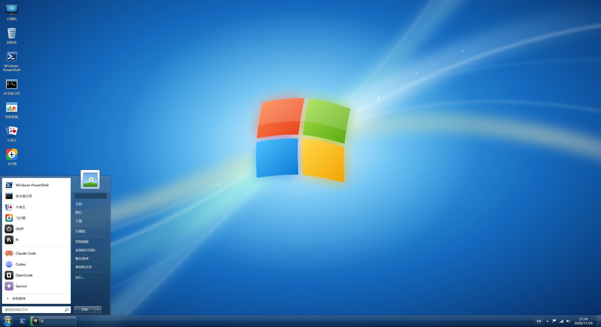

# Herdr 7

A Simplified Chinese Windows 7 Aero desktop for Herdr: terminal panes become movable glass windows over a blue, ribbon-lit wallpaper, with a Start orb, labeled taskbar buttons, desktop icons and an Explorer that treats workspaces as drives and terminals as folders. A bundled LAN 斗地主 (Dou Dizhu) game lets a human or an AI play the same seat. Optional 飞行棋 (Flight Chess) integration appears only when that separate mod is installed; it is visible in this screenshot but is not bundled. Build the behavior below, not a real Windows shell or file manager.



## What you see

- **Desktop:** fills the area above a 40 px taskbar. Cover-fit 1920×1080 wallpaper: radial sky #8fdcff → #3aa6ea → #1468bd → #05275c, luminous ribbons and a wavy orange/green/blue/yellow four-pane flag. Icons start 4 px from the left and 6 px from the top, with 10 px vertical gaps and wrapping columns. Cells are 78 px wide, art 48 px, labels white 12 px with 15 px line height and a dark 1 px shadow. Icons: 计算机, 回收站, Windows PowerShell, 命令提示符, 控制面板, 斗地主, and optional 飞行棋.
- **Terminal windows:** initially 60% of the app width × 62% of its height; cascade starts at (150,30), advances (30,28), repeats after eight slots. Normal frame: radius 7, large shadow, 1 px #0c1726d8 rim, 30 px title strip, 7 px sides/bottom. Black terminal with 1 px #4f6d8e border, Consolas 14 and 4 px padding; UI uses Microsoft YaHei UI. Title has a 16 px program icon and 12 px text on a translucent white pill. Caption buttons are 27/27/47 px wide and 20 px high; frontmost close is glossy red (#eab3a5 → #d88472 → #c4472c → #d9806a). Maximized windows cover the desktop but not the taskbar, have a 23 px title, no side/bottom strips, radius or shadow, and a #3d5574 terminal border.
- **Glass:** aligned blurred wallpaper with translucent blue tint and white highlights, not live blur of other windows. Front frame tint #d9ebfa7a → #a3c4e890; inactive #e6f0f9a8 → #c9d9eab4. Taskbar tint #24476a88 → #0b1a2cb8, dark top line and white highlight.
- **Taskbar:** 56×40 Start cell with a 46 px orb (brighter on hover), 50×36 pinned default-shell button, Explorer while open or minimized, one button per terminal, and relevant game buttons. Running buttons are 36 px high, 44–168 px wide, with 24 px art and white truncated 12 px labels; never combined. Right tray: CH, hidden-icons arrow, Action Center flag, network, volume, local two-line H:mm / YYYY/M/D clock and a 15 px Show desktop strip.
- **Start menu:** 404×532 above the left end of the taskbar. White 252 px left pane, 40 px program rows with 32 px icons: default shell, cmd, 斗地主, optional 飞行棋, OMP, Pi, then at most five other installed agents. 所有程序 expands workspaces and their terminals. Bottom search-shaped launcher is 252×26. Glass right column has 31 px location/settings/help rows, a 72 px portrait frame overlapping the top, and 78×25 关机 plus 22×25 arrow buttons.
- **Explorer:** initially 820×540 at (260,70); 24 px caption, 36 px navigation/address row, 34 px toolbar, 190 px left navigation pane and 46 px details bar. White contents show workspace drives or terminal folders in 256×60 tiles, 48 px icons and 20 px program badges. Drive capacity bars are 150×13, blue normally and orange for a blocked workspace; their fill represents terminal count, not disk usage. Search-shaped decoration is 210×24.
- **Menus and confirmation:** light #f0f0f0 context menus, #979797 border, etched icon gutter, 24 px rows and 7 px separators; hover #f1f8fd → #d5ebf8. Terminal close confirmation is 400×178 with 30 px caption, 36 px warning icon, white body and 44 px gray footer with Close/Cancel buttons.
- **斗地主:** 980×690 glass window; 28 px title, 22 px 游戏/帮助 strip, green felt #2f8f3f → #145a24. Lobby and room panels are 560 px wide. The table has opponents left/right, bottom cards and wild rank above, bid/multiplier/ante indicators, and the local hand/actions below. Own cards are 62×88 with 27 px overlap, played cards 42×60 with 17 px overlap; black #111111/red #c8102e suits and gold wild markers. Selected cards rise 16 px. Turn borders are gold; clocks become red at five seconds. MCP play shows a purple “AI 正在替你打（MCP）” banner.

## How it behaves

- **Agent attention:** working sweeps green #7cf07ca0 → #1e9b1eb8 across a button, width 10→168 over 3200 ms; blocked pulses orange #ffd08ef0 → #f07a10f0, opacity .35→1 over 1400 ms; done is steady orange #ffd59ae0 → #f39a3ae0; idle or unknown has no overlay. Action Center badges blocked/done and raises the first blocked terminal, otherwise the first done one. Clock updates each minute.
- **Windows:** click a taskbar button to raise/focus, or minimize if already in front. Right-click offers launch/new window, minimize/restore and confirmed close. Drag title strips to move; double-click a terminal title to maximize/restore; right-click for its window menu. Caption × asks before ending terminal panes. Show desktop toggles terminal windows only: Explorer and games stay visible. Normal positions survive reopening.
- **Desktop:** click selects, blank click clears, double-click activates. Selection is pale blue; hover adds a light border. Computer opens Explorer; PowerShell starts the configured default shell, cmd explicitly starts Command Prompt, Control Panel opens Herdr settings. Recycle Bin does nothing. Right-click offers view/look settings, refresh, new terminal/workspace and personalization. Refresh briefly hides icons for 160 ms and resynchronizes windows.
- **Start:** orb toggles the menu; outside press dismisses it. Location-row hover changes the portrait illustration. User/Documents/Pictures/Downloads start terminals in those home-relative folders. Computer opens Explorer; other rows open Herdr settings, machine settings, help or command palette. Search is a palette launcher, not a text input. 关机 closes the Herdr window; arrow entries switch layout, return to main, reopen all terminal windows, or minimize Herdr. They do not shut down, log off or restart Windows.
- **Explorer:** navigation single-click changes location; tile single-click selects and double-click enters a workspace or raises a terminal. New Workspace creates a workspace; New Folder creates a terminal tab in that workspace. Right-click a drive offers open/new terminal/rename; a terminal offers open/confirmed close/tab rename. These actions never manipulate disk files. Back returns to Computer, not browsing history. Minimize keeps the taskbar entry; close removes Explorer without ending terminals.
- **Claude title fallback:** every 1.5 seconds inspect otherwise unrecognized terminal titles. A leading braille spinner means working; a leading ✳ means idle. Working→idle while not in front produces a local done highlight and optional completion sound; foregrounding or renewed work clears it. This inferred completion affects the taskbar, not the host's agent state or Explorer.
- **Keys:** no keybindings ship with this package. Existing Herdr keys remain in force. Start/Desktop/Explorer/Game commands can be bound separately; displayed mnemonic letters and Alt+F4 menu hints do not install shortcuts.
- **Game lobby:** create with 1000 chips, ante 10 and an optional password; blank password generates six digits. Discover LAN rooms automatically on opening while disconnected or by refresh. Selecting a result fills its address; password and Join complete the connection. Host sees configuration, add/remove computer and Start controls. Three seats are required.
- **Game rules:** deal 17 cards each plus three for landlord; random first bidder and wild rank 3–2. Bids rise from 1 to 3, all-pass redeals, bid 3 ends bidding. Farmers choose ×1/×2/×4 before landlord. Wilds substitute ranks 3–2, never jokers; sequences stop at A. Support singles, pairs, triples/attachments, straights, consecutive pairs, airplanes/attachments, four-with-two/two-pairs, bombs and rocket. Bomb order soft < hard < four wilds < rocket; bombs and spring each double the multiplier. Per-farmer settlement is bid × multiplier × ante × landlord double × farmer double, capped by payer chips; an insolvent landlord pays farmers proportionally.
- **Game controls:** click cards to select; reset clears; Hint cycles legal suggestions, or immediately passes if none exist. Play requires a legal selection; Pass is disabled on a free lead. Human turns last 25 seconds, AI-marked turns 120; timeout makes one computer move, two consecutive timeouts enable auto play. Disconnected seats are computer-driven and can be reclaimed by the same name. Human buttons remain usable during MCP control. Minimize preserves the seat; game × or Exit leaves immediately, without terminal-style confirmation; a hosting player's exit ends the room for everyone. Again needs three seats with positive chips.
- **Optional 飞行棋:** installed separately, it adds desktop/Start launchers and a taskbar button while its window is open or a room joined. The button summarizes connection, player count, own turn, AI play or result; own turn flashes orange when its window is hidden. Clicking toggles that mod's window.

## Built from

Create this self-contained package at the repository root. Runtime files mirror the Herdr app home; do not copy personal state:

```text
RECIPE.md, preview.png
layouts/win7.json
themes/win7.json
mods/win7/mod.json, main.js, kit.js, frame.js
mods/win7/desktop.js, taskbar.js, start.js, explorer.js, menu.js, dialog.js
mods/win7/fxq.js
mods/win7/ddz/{rules.js,aes.js,server.mjs,client.mjs,net.js,table.js,mcp.mjs,package.json}
mods/win7/{wallpaper.svg,wallpaper-blur.png,orb.svg,orb-hot.svg,preview.svg}
mods/win7/icons/*.svg
art/gen.mjs, art/blur.html
install.mjs, tests/{aes,ddz,client,mcp}.mjs
```

- **Layout tree:** root column `win7-root`, `titlebar:"none"`, `movable:false`, theme `win7`, Consolas 14, Microsoft YaHei UI, terminal padding `[4,4]`, opacity 1, cover wallpaper. Flexible block `win7-desktop` hosts `win7` with `{role:"desktop"}`; 40 px block `win7-taskbar` has `window_drag:true`, gradient `#46698ed4→#14283fe8` at 180°, and `{role:"taskbar"}`. Picker preview points to `mods/win7/preview.svg`, not the repository screenshot.
- **Theme:** background #000000, foreground/cursor #c0c0c0, selection #335f8f. ANSI palette in order: #000000, #c42b1c, #13a10e, #c19c00, #2f6fe0, #a033b3, #16a0b0, #c0c0c0, #767676, #f25c4a, #4ee04a, #f2e35a, #5b9bff, #d46ae6, #5be0e8, #ffffff. Chrome/canvas/surface/popover/raised/hover/selected: #132436/#0e1c2b/#16283b/#1b2e44/#24405c/#2c5276/#2f6496. Border/input/muted/dim/accent: #3d5f82/#4d7398/#a9bfd6/#7f97b0/#3399ff. Theme working/blocked/done/idle: #4cc2ff/#ff9a2e/#5ad15a/#8aa0b6; taskbar attention deliberately uses the different colors above.
- **View composition:** native `gpui-kit` and `gpui-base`, not HTML/CSS/DOM. `mod.json` is `{"place":"none"}`. `main.js` dispatches nine roles: desktop, taskbar, title, edge, start, explorer, menu, dialog, ddz. Frame props carry `terminal`, `max`, and edge `side` l/r/b; Explorer/game use `max`; menu receives `items`; dialog receives `terminals`; Herdr supplies `overlay`. Missing role renders diagnostic text.
- **Window manager:** `kit.js` centralizes drawing, geometry, window and action helpers. Terminal windows use `openOverlay({kind:"window",frame:"none",key:"win7:<terminal>",layout})`, with title/edge mod blocks around a live terminal block. Shared `win7.windows` maps terminal IDs to `{id,open,max,slot,at}`. `win7.desk`, `win7.places`, `win7.front`, `win7.start`, `win7.explorer`, `win7.game`, `win7.claude` and `win7.refresh` coordinate copies. Maximized windows are unkeyed at (0,0). Start/context menus are unkeyed frameless windows with outside-press dismissal; close confirmation is a dialog.
- **Frost:** watch/read `<appHome>/windows.json` for saved positions, track pointer positions while dragging, and draw the corresponding cover-aligned slice of the preblurred wallpaper. Include the 40 px taskbar when calculating cover geometry. Without position measurements, show tint only. Animate status with native loops, not redraw timers.
- **Herdr APIs:** `props`, `panes`, `spaces`, `focused`, `settings`, `knownAgents`, `home`, `appHome`, `shared`, `setShared`, `nextCommand`, `openOverlay`, `closeOverlay`, `run`, `hc`, `exec`, `readTextFile`, `watchFolder`, `playSound`. Actions use `tab.new`, `tab.rename`, `space.new`, `space.rename`, `pane.focus`, `pane.close`, `app.settings`, `app.palette`, `app.help`, `layout.switch`, `window.close` and `window.minimize`. Inspect raw Claude titles with `hc get <terminal> --json`. Known-agent launchers pass their reported argv; OMP/Pi pass `["omp"]`/`["pi"]`, cmd `["cmd.exe"]`, default shell no argv.
- **Mod commands:** taskbar listens for `win7.start`, `win7.desktop`, `win7.explorer`, `win7.game`, `win7.ddz_host`, `win7.ddz_bot`, `win7.ddz_start`. Optional user bindings belong in `layout:win7`: Ctrl+Escape → start, Ctrl+Alt+D → desktop, Ctrl+Alt+E → explorer, Ctrl+Alt+G → game. Merge only with the user's consent where bindings conflict.
- **Game modules:** `rules.js` owns card IDs, wild interpretations, comparison, suggestions and bots; `server.mjs` is the authoritative room/timers/settlement; `aes.js` is portable AES-256-CTR with HMAC-SHA256 (16-byte truncated tag); `client.mjs` owns TCP/UDP, newline JSON commands, atomic state-file writes and authenticated local MCP control. `net.js` starts named `ddz-client`/`ddz-server` background Node terminals with `hc run --bg --no-parent`, sends commands with `hc send`, stops them with `hc kill`, and watches `<appHome>/data/ddz/state.json`. Queues/state use `win7.ddz.out`, `win7.ddz` and `win7.ddz.hosting`. `table.js` draws the game and dispatches actions.
- **MCP:** `mcp.mjs` is a dependency-free Node stdio server controlling the same seat, not a fourth player. Tools: `ddz_state`, `ddz_wait`, `ddz_bid`, `ddz_double`, `ddz_play`, `ddz_pass`, `ddz_rooms`, `ddz_join`, `ddz_add_bot`, `ddz_start`, `ddz_again`, `ddz_auto`. Setup: `claude mcp add ddz -- node "<appHome>/mods/win7/ddz/mcp.mjs"`. It reads the game state file for the loopback control port/token; `--state` can override that file. The UI's copy-command button runs `powershell.exe` with `Set-Clipboard`.
- **Optional dependency:** `fxq.js` detects `<appHome>/mods/fxq/mod.json`, reads/watches `data/fxq/state.json`, checks `hc get fxq-client --json`, and calls `mod.open {name:"fxq"}`. It uses that mod's `fxq.open` shared state and icon; it does not implement Flight Chess. Do not bundle someone else's installed game/state merely because its launcher appears in the screenshot.
- **Art/dependencies:** create the wallpaper/orbs with `node art/gen.mjs`; render `art/blur.html` at 1920×1080 to a PNG for `wallpaper-blur.png` (blur 16 px, saturation 1.1). The HTML does not save an image by itself. Draw the 24 SVG icons and picker preview separately. Runtime needs no browser or image generator. Generic agent/Pi/Claude and installed-agent icons come from Herdr's app-home `icons/`; optional Flight Chess art comes from its own mod. The provided Windows-like artwork is illustrative, not an official Windows asset bundle.
- **Installation:** Node and `hc` must be available for the bundled game; no npm dependencies or build step. `node install.mjs [app-home]` copies mod/layout/theme, assets before `main.js`; default home is `HERDR_APP_HOME`, otherwise `~/.config/herdr-app`. Existing names are refused unless explicitly updating; `--update` backs up existing targets. A fresh installer must not silently overwrite another layout. Fonts, agents, keys and optional Flight Chess are not installed.

## Watch out

- **Privacy before publication:** the desktop can display workspace/project names, terminal output/titles/cwd, username, machine labels and game credentials. Close unrelated windows, hide terminals and inspect the entire screenshot, including taskbar titles, before publishing. Never package `shared.json`, `windows.json`, `view.json`, `data/`, logs, installed-agent state or personal settings. A screenshot of the running desktop is not automatically safe to share.
- **Network and filesystem access:** this is not an offline-only layout. The game launches Node helpers; host TCP 17777 listens on all IPv4 interfaces and UDP discovery uses 17778. Discovery exposes room/host name, port, player count and phase in plaintext. MCP control uses an ephemeral localhost TCP port and token. `data/ddz/state.json` contains the room password, token/port, own hand, player names and addresses. The desktop also reads app-home window positions, local terminal metadata and optional Flight Chess state outside its mod folder.
- **Trusted LAN only:** room encryption derives keys directly from password hashes, without password stretching; the generated password is six digits, and reconnecting seat identity is only a matching name. Do not claim hardened authentication or expose the game through internet port forwarding. Password fields are not masked. Windows Firewall may ask about Node; restrict access to trusted private networks. IPv6 literal addresses are unsupported.
- **Game limits:** three seats; chips and room state are memory-only. Client does not automatically reconnect after an established connection drops. Hosting-player Exit kills the server. Postgame UI has no chip-reset fields; bankruptcy can block Again, so recreating the room is the ordinary UI escape. Although Start is host-only in the lobby UI, server start/again accepts any seated player. The clipboard button can say copied even when PowerShell fails.
- **Visual limits:** no edge resizing, Aero Snap, Peek or live thumbnails. Nonterminal mod panes are omitted. Taskbar overflow clips with no pager; drive letters clamp to Z after 24 workspaces. Fixed-size overlays are divided by zoom, but small windows can still clip. Font availability affects appearance; missing Consolas falls back through Herdr. The PowerShell label does not guarantee PowerShell is the configured shell.
- **Decorations, not features:** Recycle Bin Open is disabled; Explorer search and Forward do nothing; Back has no history. Tray CH/arrow/network/volume/clock have no click actions. Network status is fixed; volume only reflects Herdr's sound setting. Game Help entries are disabled explanatory text. OMP/Pi remain pinned even if absent, and home-relative Documents/Pictures/Downloads must actually exist.
- **Host/runtime traps:** overlays cannot blur underlying windows, hence wallpaper sampling. Keyed windows restore their saved position rather than always honoring `at`; maximize uses an unkeyed window. Window overlays require menus above them to be windows too. Never replace this with browser DOM APIs, Node sockets inside the GPUI view, or a redraw timer for animation. Use helper processes for sockets; honor the host's context-lifetime rules.
- **Check coverage:** `herdr-app check mods/win7` only renders the role-less initial view; it does not prove deferred views, overlay geometry, network states or interactions. Exercise actual roles in the running app too. Old source headers mentioning `extensions/win7` are historical; commands here run from the package root. Generated type files and editor configuration are not runtime package dependencies.

## Done when

These are acceptance checks for a rebuilt implementation, not a claim that every check was run for this documentation update.

- The package includes its layout, theme, mod modules, artwork, this brief and a privacy-reviewed screenshot named preview.png; it installs without copying personal state or overwriting unrelated names.
- Herdr's mod check passes; switching to win7 renders the desktop/taskbar and live status reports no layout/mod errors. Inspect the actual screen, not just the role-less check.
- Terminal windows drag, minimize/restore and maximize above the taskbar. Close→Cancel preserves a terminal; confirmed close ends it. Show desktop changes only terminal windows. All four agent states render as specified; inferred Claude completion clears on foregrounding.
- Start launches the configured shell/agents and correct Herdr settings/palette actions; outside clicks dismiss it. Explorer lists real workspaces and terminal panes; create/rename/close act on the correct model objects, not filesystem entries. Decorative controls stay explicitly nonfunctional.
- Without Flight Chess installed, its launchers are absent; with it installed and live, launch/toggle and own-turn attention work. A screenshot showing that integration does not imply it is bundled.
- For game changes, run the focused existing checks: node tests/aes.mjs (AES parity, wrong-password/tamper rejection), node tests/ddz.mjs (rules and server games), node tests/client.mjs (client/state/discovery), node tests/mcp.mjs (same-seat AI lifecycle). Network tests start real processes/listeners and may take 90–180 seconds; run serially because discovery shares port 17778. Do not run them merely to verify prose or a new screenshot.
- Manually discover/join a trusted-LAN room, reject a wrong password, complete a game with two bots, exercise selection/hints/pass and doubling, and verify MCP visibly controls the same seat. Minimize preserves membership; Exit leaves and hosting Exit ends the room. Never capture a visible room password or private hand for publication.
- The public GitHub repository contains this package and the topic herdr-layout. Only the reviewed screenshot is committed; unrelated projects, credentials and state files are absent.
