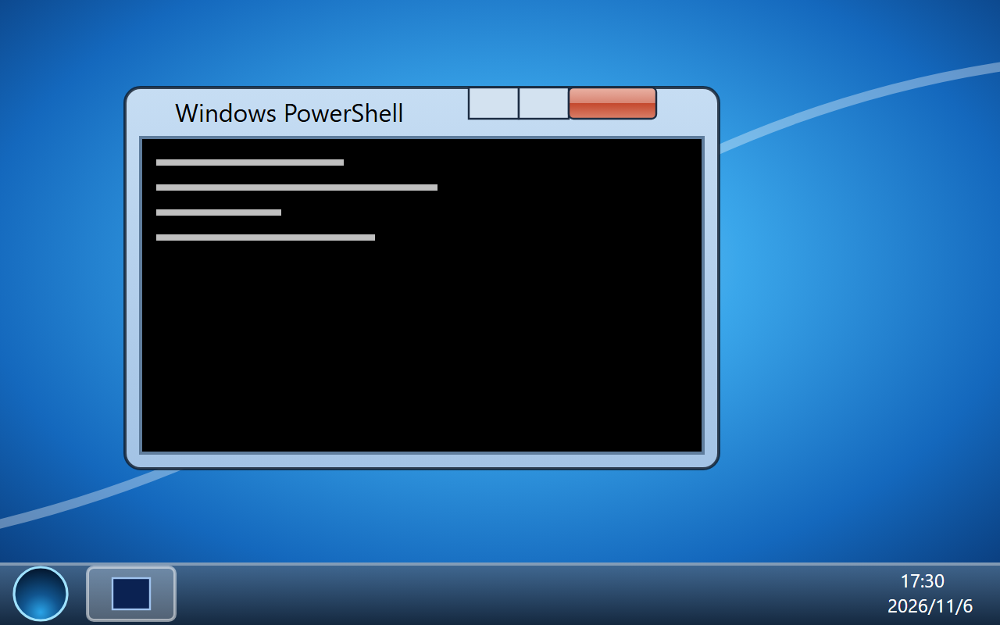

# Herdr 7

A Windows 7 Aero desktop for Herdr: every terminal is a draggable glass window over a blue "Harmony"-style wallpaper, with the superbar, the Start orb and menu, desktop icons, and a fake Explorer whose drives are spaces and whose folders are terminals, and a LAN 斗地主 (Dou Dizhu) card game that people and AI agents (through MCP) play together. UI text is Simplified Chinese, as on a zh-CN Windows 7.

## What you see

- **Desktop** (whole window above a 40 px taskbar): `mods/win7/wallpaper.svg` (radial sky `#8fdcff → #1468bd → #05275c`, light ribbons, a wavy four-pane flag), cover-fit. Icons down the left (78 px cells, 48 px art, white 12 px labels with a 1 px dark shadow): 计算机, 回收站, Windows PowerShell, 命令提示符, 控制面板.
- **Windows**: an overlay per terminal pane, 60 % × 62 % of the app window, cascaded 30/28 px. 1 px dark rim `#0c1726d8`, radius 7, `shadow: lg`. A 30 px title bar (program icon 16 px, title on a soft white pill) and 7 px side/bottom edges are mod blocks drawing frosted glass; the terminal sits in the middle with a `#4f6d8e` 1 px border, black background. Caption buttons hang from the top edge: 27 + 27 + 47 × 19 px, glossy two-half faces, the close button red (`#eab3a5/#d88472 | #c4472c/#d9806a`) on the window in front.
- **Taskbar**: frosted dark glass with a 1 px light top line. Start orb (46 px SVG, lit on hover), pinned PowerShell (icon only), an Explorer button while it's open, then one labeled button per window (never combined; ≤ 168 px, 24 px icon, white 12 px truncated title). Tray: `CH`, ▲, Action Center flag, network, volume, a two-line clock (`17:43` / `2026/11/6`), a 15 px Show desktop strip.
- **Start menu** (404 × 532 frameless window above the orb): white left pane (PowerShell, 命令提示符, OMP, Pi pinned; installed agents below; 所有程序 lists spaces as folders), the search box, a glass right column (user, 文档, 图片, 下载, 计算机, 控制面板, 设备和打印机, 默认程序, 帮助和支持, 运行...), a 72 px picture frame overlapping the top edge, 关机 with an arrow menu.
- **Explorer** (820 × 540): glass top with Back/Forward orbs, a breadcrumb address bar and a search box; command bar; navigation pane (计算机 and each space as a drive `name (C:)`); tiles (drives with a capacity bar = terminal count; folders with a program badge, status and cwd); details pane.

- **斗地主** (980 × 690 game window, glass frame, 游戏 / 帮助 menu bar, green felt): a lobby (create a room with starting tokens, ante and password; rooms found on the LAN; join by address and password), a room (seats, the password and addresses for the host, computer players, the MCP command for AI players), and the table (the two others left and right with role, tokens, cards left and the turn clock; bottom cards, 赖子, base, multiple and ante on top; your hand of 62 × 88 cards with 叫分 or 不出 / 提示 / 出牌, and 托管).

## How it behaves

- Agent status on taskbar buttons: `working` = green progress sweeping across (`loop width`), `blocked` = orange flashing (`loop opacity`), `done` = steady orange, `idle` = plain. The tray flag gets a red badge when something needs you; clicking it raises that window.
- Taskbar button click: raise and focus the window, or minimize it if it's already in front. Right-click: jump list (new window, minimize/restore, close).
- Title bar: drag moves, double-click maximizes (a frameless full-desk overlay at 0,0), right-click is the window menu. × asks first (a Win7 message box), then `pane.close`.
- Desktop: click selects, double-click opens; right-click: 查看, 刷新 (icons blink, windows re-synced), 新建终端, 新建工作区, 屏幕分辨率, 个性化.
- Explorer: double-click a drive to enter, a folder to raise its window; 新建文件夹 = `tab.new {space}`; right-click a folder: 打开, 删除 (close), 重命名.
- Start: 关机 = `window.close` (terminals keep running); arrow menu: 切换用户 (`layout.switch`), 注销 (`layout.switch main`), 重新启动 (reopen every window), 睡眠 (`window.minimize`).
- Claude Code started from a shell on Windows is recognized by its raw title (`hc get`, every 1.5 s): `✳` waiting, a braille spinner working.

- 斗地主: bids of 1–3; each deal turns up a 赖子 rank that stands for any rank 3–2; bombs 软炸 < 硬炸 < 四赖子 < 王炸, each ×2, spring ×2. Tokens move base × multiple × ante per farmer (the landlord against both), never below zero. 25 s a turn (120 s for an AI seat): a timeout plays that turn by computer, two in a row turn on 托管; a dropped player is played by computer until they return under the same name. The taskbar button flashes orange on your turn.

## Built from

- `layouts/win7.json`: a column, `titlebar: none`, `movable: false`, theme `win7`, Consolas 14, Microsoft YaHei UI, wallpaper background; children `win7-desktop` (mod `win7`, role `desktop`) and `win7-taskbar` (40 px, `window_drag`, role `taskbar`).
- `themes/win7.json`: cmd-like black/`#c0c0c0` terminal, readable ANSI, navy panel colors.
- `mods/win7/` roles: `desktop`, `taskbar`, `title`, `edge` (side `l`/`r`/`b`), `start`, `explorer`, `menu`, `dialog`. `kit.js` holds the window manager (shared `win7.windows`: `{terminal: {id, open, max, slot, at}}`), `frost()`, the program icons and `perform()` for menu actions.
- Windows: `openOverlay({kind: "window", frame: "none", key: "win7:<t>", layout})`; menus, Start and thumbnails are unkeyed frameless windows that close on `on_mouse_down_out` (popups draw under windows).
- Frosted glass: each glass element draws its slice of `wallpaper-blur.png` (pre-blurred, from `art/blur.html` in headless Chrome) placed where cover-fit puts the wallpaper, using the window's spot from `windows.json` (watched with `watchFolder`, kept in shared `win7.places`) and live pointer positions while dragging.
- Calls: `panes`, `spaces`, `focused`, `knownAgents`, `hc`, `readTextFile`, `watchFolder`, `playSound`, `run` (`tab.new`, `space.new`, `pane.focus`, `pane.close`, `tab.rename`, `space.rename`, `app.settings`, `app.palette`, `app.help`, `layout.switch`, `window.*`). Runs `hc get <t> --json` for Claude detection; no network.
- Art: `art/gen.mjs` (wallpaper, orb), hand-written SVGs in `mods/win7/icons/`.

- 斗地主: `ddz/rules.js` (cards, plays with 赖子 readings, hints, computer players); `ddz/server.mjs` (node, TCP 17777, UDP discovery 17778, the authoritative table); `ddz/aes.js` (pure-JS AES-256-CTR + HMAC-SHA256, keys from the room password, byte for byte the same in node and the mod); `ddz/client.mjs` (node, the window's connection: JSON commands on stdin through `hc send`, state written to `data/ddz/state.json`); `ddz/net.js` (the taskbar side: starts ddz-client / ddz-server with `hc run --bg`, watches the state file); `ddz/table.js` (the window); `ddz/mcp.mjs` (MCP stdio server: ddz_rooms, ddz_join, ddz_state, ddz_wait, ddz_bid, ddz_play, ddz_pass, ddz_add_bot, ddz_start, ddz_again, ddz_auto, ddz_leave). Tests in `tests/`.

## Watch out

- Never use the mod runtime's own `net` sockets: a stuck connect took down every mod in Herdr (all showed `Null"null"`) until the app restarted. Keep sockets in a separate node process.
- The mod's `crypto.createHash().update()` hashes a Uint8Array as nothing; pass a plain array (aes.js checks which).
- 斗地主 needs node on every player's machine; Windows Firewall asks about node the first time a room opens.

- Overlays can't blur what's behind them: the glass shows the blurred wallpaper, never other windows.
- A keyed window opens where it was last dropped; `at` only counts the first time, so maximize uses an unkeyed overlay.
- Popups draw under windows; anything that must sit over a window has to be a window itself.
- `herdr-app check` only checks the role-less copy; check each role by forcing `props().role` in a copy.
- No edge resizing, Aero Snap or live thumbnails. Non-terminal mod panes don't show on this desktop.
- OMP and Pi are pinned whether or not they're installed.

## Done when

- `herdr-app check mods/win7` passes and `herdr-app status` shows `errors: []` after `layout.switch --name win7`.
- Every terminal pane shows as a glass window; minimizing hides it and its taskbar button brings it back; × asks before closing.
- `herdr-app do win7.start` opens the Start menu over the windows; `win7.explorer` opens 计算机 listing every space.
- An agent at work shows green progress on its taskbar button.
- `node tests/aes.mjs`, `tests/ddz.mjs`, `tests/client.mjs` and `tests/mcp.mjs` pass.
